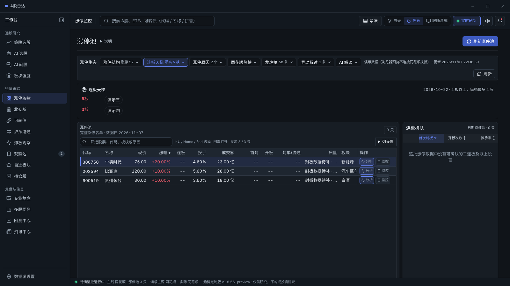
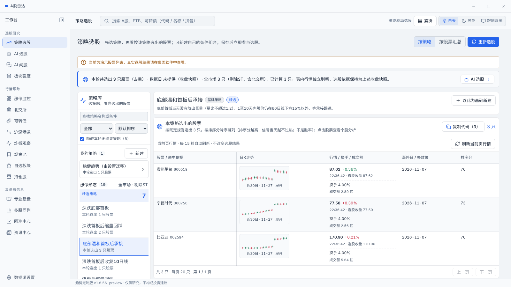
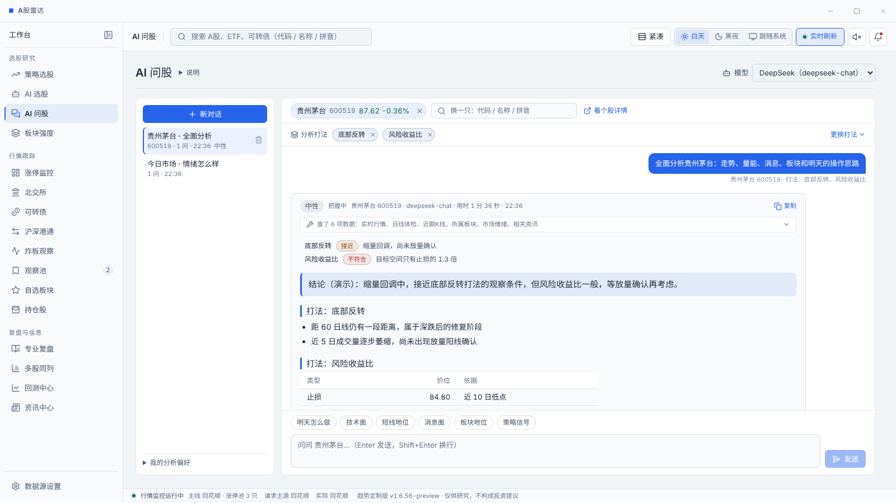
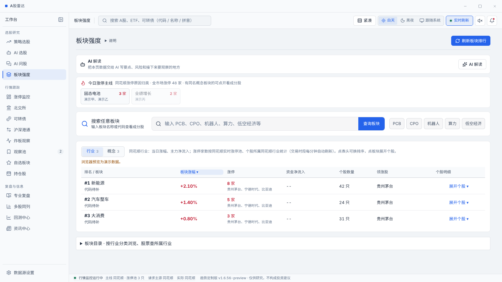
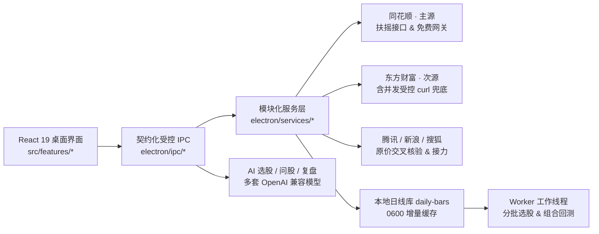

<div align="center">
  

  <h1>A-Share Quant Radar · A股雷达 v1.6.71</h1>

  <p><strong>面向 A 股实盘研究的全景驾驶舱、全市场策略选股、AI 选股/问股/复盘、盘中做T与可审计回测桌面工作台</strong></p>
  <p>从盘前计划、竞价核对、盘中哨兵与做T，到盘后全市场选股、五步专业复盘与网盘加密备份，把分散的研究闭环收进一个安全纯粹的跨平台桌面应用。</p>

  <p>
    <a href="https://github.com/tlyer666666/a-stock-radar-tader/releases/latest"></a>
    
    
    
    
    <a href="https://github.com/tlyer666666/a-stock-radar-tader/actions/workflows/qa.yml"></a>
  </p>

  <p>
    <a href="https://github.com/tlyer666666/a-stock-radar-tader/releases/latest">下载最新版</a> ·
    <a href="#-核心能力1671">核心能力</a> ·
    <a href="#-界面导览">界面导览</a> ·
    <a href="#-策略选股与回测">策略与回测</a> ·
    <a href="#-技术架构与安全基座">技术架构</a> ·
    <a href="docs/daily-workflow-guide.md">五段式实盘指南</a> ·
    <a href="#-安装与开发">安装与开发</a>
  </p>

  <p><strong>简体中文</strong> · <a href="README_EN.md">English</a></p>
</div>

---

> [!IMPORTANT]
> 本项目用于行情研究、规则验证、AI 辅助分析与模拟记录，不构成投资建议，不提供收益保证，也不执行真实券商交易。

## 🚀 1.6.71 近期重点演进摘要

- **1.6.71 全栈安全加固、体验闭环与性能治理**：
  - **今日驾驶舱与全时段闭环**：按盘前 / 盘中 / 盘后自动切换工作视图，统一汇总实盘持仓、核心自选、模拟仓、价格哨兵、随心记待办与已存趋势计划盘后对账。
  - **全市场策略选股实时进度**：选股进行中实时反馈已抓取日线数、已计算股票数、当前命中标的数与预计剩余秒数（ETA），复用 `strategy:scan` 通道零膨胀查询。
  - **多源熔断共享与可读中文诊断**：升级趋势与选股适配器的模块级故障主机与同花顺熔断记忆，避免重扫瞬间遗忘刚限流的节点；东财备用通道加入进程级并发闸门（上限 2）并跳过 `429/403` 限流风暴；数据源异常统一翻译为简洁中文提示。
  - **沪深港通内嵌视图安全与个股桥接**：补齐子帧导航（`will-frame-navigate`）同花顺白名单拦截、主窗口缩放同步、连续崩溃 3 次熔断保护、退出登录连带清缓存，以及浏览同花顺 6 位 A 股个股页时自动识别代码供软件内一键打开个股分析。
  - **本机权限收紧、窗口自适应与跨窗恢复防竞争**：启动早期自动将 `userData` 目录收紧为 `0700`、`.json`/`.key` 收紧为 `0600`；本地日线库新增残留 `.tmp` 自动清扫、退市孤儿日线清理与一键缓存回收；大容量集合（随心记、复盘归档、回测历史）支持内置 `node:sqlite` 持久化；备份密码强制 `>= 8` 位（兼容旧备份解密）并提供可选「启动主密码保护」二次加密包裹本机密钥；恢复备份前自动安全关闭独立复盘窗口；主窗口与独立复盘窗口均按主屏幕 `workAreaSize` 自适应钳制并记忆上次位置尺寸，完美适配 13 寸笔记本屏幕。
- **1.6.66–1.6.70 随心记 AI 盯盘、炸板增强与做T体验升级**：
  - **随心记接入 AI 与盘中价格盯盘**：支持盘前盘后偏移、股票全名联想、交易时段每 15 秒自动盯价格条件并发系统通知、「AI 整理」自然语言待办以及「让 AI 看看」结合实时分时给出处理建议。
  - **炸板观察与做T工具箱打磨**：炸板观察接入同花顺扶摇开板次数并支持按开板次数排序、保留单日异常旧快照；做T助手记住 K 线周期/复权/指标，支持滚轮围绕光标缩放、拖拽平移、手动画线（水平线/趋势线/区间测量）与页内 AI 连续追问。
- **1.6.60–1.6.64 网盘加密备份、随心记与全页核查**：
  - **网盘加密备份**：一键选用 iCloud 云盘、Google 云端硬盘、OneDrive、坚果云同步文件夹，支持 `scrypt` + `AES-256-GCM` 整包密码加密与跨机无损恢复（保留新机已有 API Key/令牌）。
  - **北交所 30% 涨停识别与可转债异步核对**：北交所按 30% 涨跌幅规则实时判定涨停；可转债老券每 7 天后台核对不阻塞首屏行情。

<details>
<summary>展开查看 1.6.20 – 1.6.59 关键里程碑归档</summary>

- **1.6.57–1.6.59**：新增「做T助手」与多周期画线工具箱（分时均价与波动率上下轨、正T/倒T未完成跟踪、T+1 可卖股数动态扣减、扣除佣金/印花税/过户费净价差目标、单边行情过滤）；板块强度统一按「真实成分名单 ∩ 实时涨停池」计数。
- **1.6.53–1.6.56**：新增对话式「AI 问股」（自主多轮查行情/分时/K线/公告/龙虎榜/板块/策略信号）与 **19 种内置分析打法 + 自定义打法**；内置交易所休市日历延长至 **2027 年底**；完成跨站重定向凭据剥离与坏日线同日自愈等全链路安全修复。
- **1.6.51–1.6.52**：基于 2021–2026 全 A 日线回放留强去弱——精选 **7 条优势策略**（深跌底部首板、深跌首板后缩量回踩、底部温和首板后承接、深跌首板后收复10日线、连板后缩量回调、涨停高开支撑守卫、下跌后放量大阳·次日平量），下线 24 条长期跑输基线规则；AI 选股新增 **「实测胜率」** 维度；扶摇接口区分交易/休市缓存。
- **1.6.49–1.6.50**：密钥全面改用本机随机密钥文件（`local-secret.key`，`0600`）做 `AES-256-GCM` 加密并启用 `use-mock-keychain`，彻底消除每次升级重签后 macOS 钥匙串重复弹登录密码的问题；AI 任务统一并发限流与退出排空。
- **1.6.33–1.6.47**：上线「AI 选股」（最多 8 套模型配置、1–4 套并行打分与分歧标注、14 套策略自动编排、近 30 日公司公告排雷、我的股票清单、大白话生成自定义策略）与「AI 市场复盘 + 回看上次判断」；全站表格响应式防截断重排与东财/新浪全市场名单 7 日兜底缓存。
- **1.6.20–1.6.32**：升级至 Electron 44；策略选股升级为 **沪深京全市场非 ST A 股**（取消早期 300 只上限）并建立本机增量日线库 `daily-bars`；新增同花顺实时分时、扶摇批量快照主源、可转债板块与独立沙箱「沪深港通」板块。

</details>

---

## 🎯 项目定位

**A-Share Quant Radar（A股雷达）** 是一套本地优先的跨平台桌面研究工作台，覆盖 **沪深主板、创业板、科创板、北交所非 ST A 股** 以及 **场内 ETF、可转债** 的实时行情跟踪、全市场规则选股、AI 深度研判、盘中做T辅助与可审计历史回测。

核心工程准则：

1. **数据源主次分明、熔断共享**：固定以 **同花顺（扶摇官方接口 + 免费网页网关）为主源**，**东方财富为次源**，**腾讯 / 新浪 / 搜狐为交叉校验与故障接力**；单路限流自动指数退避熔断并展示直白中文状态。可转债、北交所这类大名单的行情先读腾讯批量快照、取不到的再用同花顺逐只补齐；个股行情、预警与止损仍走同花顺优先链路。
2. **全市场选股可追溯、不伪造数据**：策略选股扫描全市场约五千余只合格 A 股（依托本机 `daily-bars` 增量日线库），缺失字段保持 `null`/`暂缺`，绝不把缺失涨跌幅显示为 `0.00%` 或用 `收盘价 × 成交量` 伪造成交额。
3. **回测与模拟严守 A 股交易制度**：严格执行交易所休市日历、次日开盘/区间可成交性、一字涨跌停阻断、`T+1` 交收、科创板 200 股 / 北交所 100+1 股手数约束以及双边税费滑点核算。

---

## ✨ 核心能力（1.6.71）

| 功能域 | 模块 | 核心能力说明 |
| --- | --- | --- |
| **全局总览** | **今日驾驶舱** | 盘前 / 盘中 / 盘后三态自适应工作台；聚合持仓盈亏、自选异动、模拟持仓、盘中价格哨兵、今日随心记待办与已存趋势计划盘后对账 |
| **选股研究** | **策略选股** | 沪深京全市场非 ST 股票分批流式扫描（实时显示抓取/计算进度与预计剩余时间）；内置 7 条实测精选策略 + 12 条扩展策略 + 声明式「我的策略」（支持大白话 AI 生成） |
| **选股研究** | **趋势筛选与计划** | 2–6 周上升趋势多阶段漏斗筛选、原价/前复权双轨核验、中证全指 `MA60` 市场关口检查、冻结入场/止损计划与次日开盘执行核验 |
| **选股研究** | **AI 选股** | 支持 DeepSeek / 通义 / Kimi / 智谱 / OpenAI / Ollama 等多模型（1–4 套并行打分，分差 ≥20 标「模型分歧」）；14 套策略自动编排 +「实测胜率」+「消息公告」维度，「重大风险公告」硬规则一票封顶；支持策略候选与「我的股票」（最多 40 只） |
| **选股研究** | **AI 问股** | 对话式深度投研智能体：自主多轮调用实时报价、日线体检、分时、K 线、公告、涨停龙虎榜、板块强度与策略命中；内置 **19 种分析打法**（短线情绪/波段趋势/量价技术/消息资金/持仓风控）与自定义打法自由叠加 |
| **行情跟踪** | **涨停监控 & 炸板观察** | 实时涨停池、连板天梯、涨停结构（封板率/最高板）、涨停原因、同花顺 1h/24h 热榜、龙虎榜、异动解读、T+1 至 T+10 观察池；炸板观察含扶摇开板次数与多日回溯 |
| **行情跟踪** | **个股分析 & 多股同列** | 同花顺实时分时（241 点均价对称轴）与 1/5/15/30/60/120 分钟及日周月 K 线，MA/BOLL/VOL/MACD/KDJ/RSI 叠加，三线行情共识校验，个股 AI 点评与最多 6 股同列对比 |
| **行情跟踪** | **做T助手 & 工具箱** | 分时均价线与波动率上下轨提示倒T高抛/正T低吸，严格计算 `T+1` 今日可卖股数与扣费净价差；内置多周期 K 线滚轮缩放、手动画线（水平线/趋势线/区间测量）与做T内 AI 连续问答 |
| **行情跟踪** | **板块 / 北交所 / 可转债 / 沪深港通** | 行业与概念双榜（真实成分 ∩ 实时涨停池计数）、同花顺细分分类查询；独立北交所全量名录（30% 涨停识别）；可转债实时筛选排序；独立沙箱「沪深港通」网页嵌入及 6 位个股代码一键跳转分析 |
| **复盘与信息** | **专业复盘** | 五步有序决策流（`ordered-evidence-v2`）、八维市场状态、**5 组 20 因子**个股诊断、AI 市场复盘与「回看上次判断」兑现核对、复盘档案及独立副屏窗口；详见 [专业复盘说明](PROFESSIONAL_REVIEW.md) |
| **复盘与信息** | **随心记 & 资讯中心** | 自然语言识别交易日提醒时间与盘中价格条件（15 秒轮询 + 后台系统通知 + 语音播报 + 到点「让 AI 看看」）；财联社电报快讯与公司公告风险分级 |
| **验证与工作区** | **回测中心 / 模拟仓 / 加密备份** | 单股多策略投票回测、最多 30 股共享现金组合回测、符合沪深京手数与涨跌停规则的模拟交易；支持 iCloud / Google Drive / OneDrive / 坚果云 `AES-256-GCM` 密码加密自动备份与跨机恢复 |

---

## 📸 界面导览

> 截图使用内置演示预览数据生成，仅用于展示界面布局，不代表实时行情、模型结论或策略收益。重新生成：`corepack pnpm build:web && npx vite preview --port 4173`，随后运行 `corepack pnpm docs:screenshots`。

| 涨停监控 | 全市场策略选股 |
| :---: | :---: |
|  |  |
| **AI 问股** | **板块强度** |
|  |  |

---

## 🧠 策略选股与回测

### 全市场策略选股与本地增量日线库

- **扫描范围**：覆盖沪深主板、创业板、科创板、北交所全部非 ST、`*ST` 及非退市整理 A 股（上市满 120 个交易日），无 300 只数量上限。
- **本地日线库（`userData/daily-bars`）**：首次全市场选股按批下载不复权日线并落盘（中途取消亦保留已下进度）；此后每个交易日优先使用全市场名单自带收盘快照或同花顺扶摇批量快照（经收盘时点、昨收连续性、真实成交与量额单位一致性校验）直接补齐最新一根，日常选股仅需数秒至十余秒。
- **精选与自定义策略**：按 2021–2026 全市场实盘口径回放筛选出 7 条核心精选策略置顶展示，其余在用策略归入「更多策略」；支持声明式条件编辑器或用大白话由 AI 辅助生成「我的策略」（可选全市场或仅扫自选与持仓）。

### 单股回测与共享现金组合回测

- **单股回测**：支持单策略或多策略同日投票阈值，默认按信号次一主市场交易日开盘成交；自定义限价仅在落入次日真实 `[最低价, 最高价]` 区间内才计成交，一字涨停及停牌日严格阻断，不虚构收益。
- **组合回测**：最多 30 只股票共用单一现金账户回放，遵守整手约束、最大持仓数与单股仓位上限；当日平仓资金次一交易日方可复用，杜绝未来资金提前开仓。

---

## 🏗️ 技术架构与安全基座



| 层级 | 技术栈与职责 |
| --- | --- |
| **Renderer** | React `19.3`、TypeScript `5.9`、Vite `8.3`；按业务域拆分的 `src/features/*` 工作区与独立复盘双入口 |
| **Desktop & IPC** | Electron `44.9`；单实例锁、`workAreaSize` 自适应窗口、沙箱化 `contextBridge`、`electron/ipc/*.ipc.cjs` 全通道结构化校验 |
| **Services** | Node.js 零第三方运行时依赖服务层（`electron/services/*`）；多源行情编排、共享熔断器、有界内存缓存、公告与短线生态聚合 |
| **Compute** | 独立 `worker_threads` 工作线程池；全市场 400 只分批特征计算、单股/组合历史回放与趋势研究 |
| **Security & Storage** | `0700` 数据目录与 `0600` 原子 JSON 双写（`.last-good` 自动恢复 + 异步写队列）、内置 `node:sqlite` 大容量本地存储、本机 `AES-256-GCM`（`local-secret.key` + 可选主密码锁 `AS2`）凭据加密、网盘加密备份（`>= 8` 位异步 `scrypt`）与恢复前跨窗安全关闭 |
| **Quality** | 双入口 TypeScript 严格检查、ESLint 10、2,080+ 项禁网隔离单测、21 组 Playwright 全栈 UI 套件、Electron Fuses 与 SHA-256 构建回执核验 |

完整目录职责与维护规范请参阅 [项目架构与维护边界](docs/ARCHITECTURE.md)。

---

## 🛠️ 安装与开发

### 正式版运行与 macOS 首次打开说明

可从 [GitHub Releases](https://github.com/tlyer666666/a-stock-radar-tader/releases/latest) 下载对应平台发行包（`Windows-x64-Portable.zip`、`macOS-arm64.zip`、`macOS-x64.zip`、`Linux-x86_64.AppImage`），或在 macOS 交付目录直接双击 `打包并安装最新版.command` 由源码一键构建安装。

- **macOS 首次打开提示**：当前构建使用本机 ad-hoc 签名（暂未配置 Apple Developer ID 公证）。从网络下载后首次运行若遇系统安全拦截，请在「访达」中按住 `Control` 右键点击应用图标选择「打开」，或在「系统设置 → 隐私与安全性」中点击「仍要打开」（如提示「已损坏」，可在终端执行 `xattr -cr "A股雷达趋势版.app"` 后打开）。
- **Linux AppImage**：首次运行前执行 `chmod +x 文件名.AppImage`。
- **可选数据源与 AI 配置**：软件开箱即可通过免费公开行情工作；如需同花顺扶摇、QuantAPI 或 AI 助手增强，可在「设置」中填入对应 API Key / Token。所有密钥均以本机 `0600` 权限 `AES-256-GCM` 加密保存在用户数据目录，不上传网盘、不写入仓库。

### 本地开发与验证命令

环境要求：**Node.js `>=22.12 <25`**、**pnpm `>=11`**（建议通过 `corepack enable` 启用 `pnpm@11.16.0`）。

```bash
# 安装锁定依赖与启动开发模式
corepack pnpm install --frozen-lockfile
corepack pnpm dev

# 全量无头质量门禁（双入口类型检查 + Lint + 覆盖率单测 + Web/复盘双构建）
corepack pnpm verify

# 构建 Windows 便携未封包目录（release/win-unpacked） / 跨平台发行包 / macOS 唯一软件原子部署
corepack pnpm build
corepack pnpm dist:platform
corepack pnpm run deploy
```

---

## 🤝 反馈与风险声明

欢迎通过 [GitHub Issues](https://github.com/tlyer666666/a-stock-radar-tader/issues) 反馈问题（请附版本号、股票代码、发生时间、所在模块与脱敏后的错误提示，切勿上传 API Key、行情令牌或个人实盘账户敏感信息）。

**风险声明**：证券市场存在显著风险。软件中的评分、策略选股、AI 结论、做T提示、资讯分级与历史回测均可能存在误差或阶段性失效，历史表现不代表未来收益。任何交易决策、资金损益及第三方数据源/模型服务条款责任均由使用者自行承担。

---

<div align="center">
  <sub>Built for auditable A-share research · A-Share Quant Radar v1.6.71</sub>
</div>
