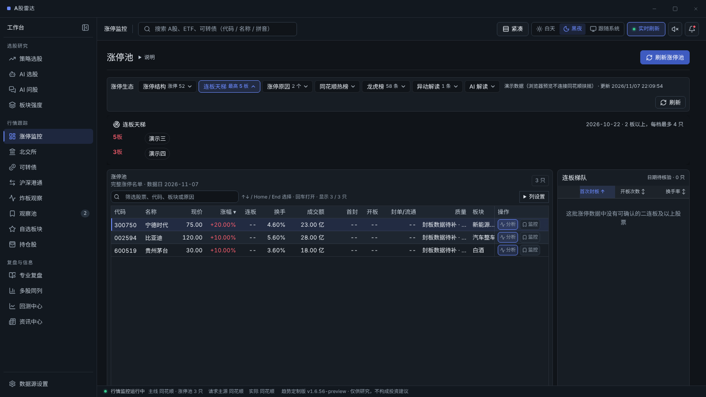
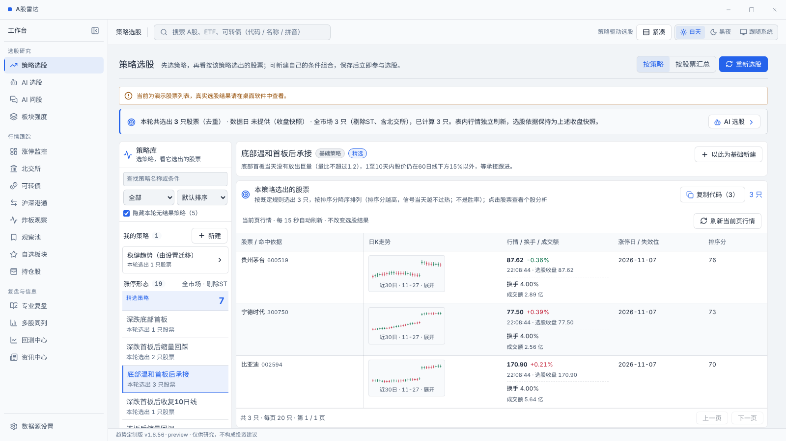
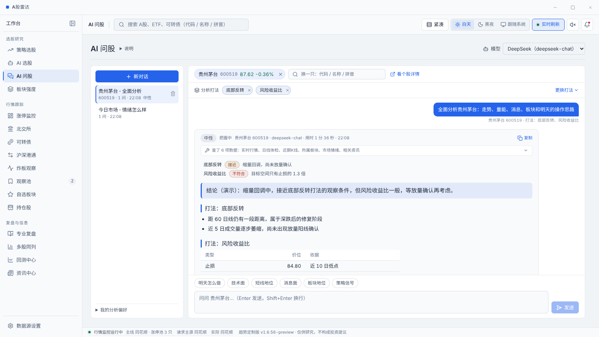
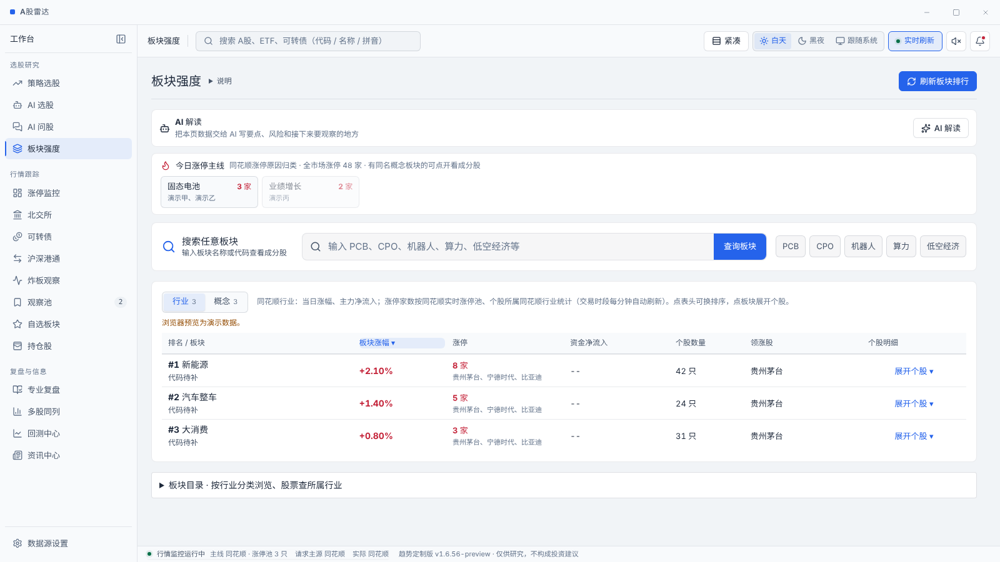
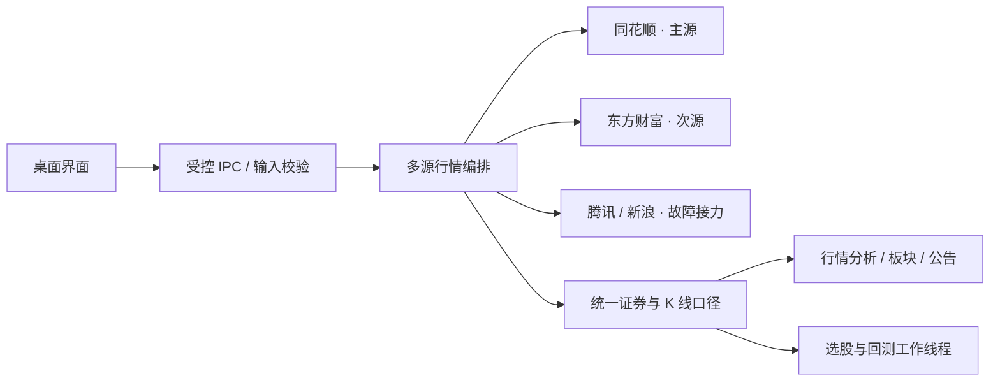

<div align="center">
  

  <h1>A股雷达</h1>

  <p><strong>面向 A 股短线与波段研究的本地桌面工作台</strong><br/>涨停监控 · 策略选股 · AI 问股 · 专业复盘 · 回测</p>

  <p>
    <a href="https://github.com/tlyer666666/a-stock-radar-tader/releases/latest"></a>
    
    
    
    <a href="https://github.com/tlyer666666/a-stock-radar-tader/actions/workflows/qa.yml"></a>
  </p>

  <p>
    <a href="https://github.com/tlyer666666/a-stock-radar-tader/releases/latest"><b>下载最新版</b></a> ·
    <a href="#界面预览">界面预览</a> ·
    <a href="#主要功能">主要功能</a> ·
    <a href="#从源码运行">从源码运行</a>
  </p>
</div>

---

A股雷达把每天盘后要做的几件事放在一个窗口里：看涨停和连板、按规则筛股、让 AI 对单只股票做一次完整分析、写复盘、回放策略。行情来自同花顺、东方财富等多个数据源，自选、持仓、对话记录和回测历史都只保存在你自己的电脑上。

> [!IMPORTANT]
> 本项目用于行情研究、策略验证与模拟记录，不构成投资建议，不提供收益保证，也不执行真实证券交易。

## 界面预览

<p align="center">
  
  <br/><sub>涨停监控：涨停生态、连板天梯与完整涨停池</sub>
</p>

<table>
  <tr>
    <td width="33%" align="center"><br/><sub>策略选股</sub></td>
    <td width="33%" align="center"><br/><sub>AI 问股与分析打法</sub></td>
    <td width="33%" align="center"><br/><sub>板块强度</sub></td>
  </tr>
</table>

<sub>截图使用项目内置的演示数据，AI 问股中的回答也是演示文字，不代表实时行情、模型输出或策略收益。</sub>

## 主要功能

### 选股研究

- **策略选股**：19 套内置规则（深跌底部首板、连板后缩量回调、弱转强、涨停后量价收缩等），按形态家族筛选；也能用条件组合写自己的策略。结果可按策略或按股票汇总，附日 K 走势和入选依据，一键复制代码导入同花顺自选。
- **AI 选股**：把策略候选或自己的股票交给大模型打分点评。基础分由软件按框架计算，AI 只在有限范围内微调并写出理由。
- **AI 问股**：像聊天一样分析一只股票。AI 自己决定查哪些数据（行情、K 线、分时、涨停与龙虎榜、所属板块、公告资讯、策略信号等），查询过程实时可见，可以连续追问。
- **分析打法**：问股时可叠加 1–3 种打法，内置短线情绪、波段趋势、量价技术、消息资金、持仓风控五类共 19 种，也可以自己编写。回答逐条对照，并给出每种打法「符合 / 接近 / 不符合」的结论。
- **板块强度**：行业与概念排行、今日涨停主线、成分股实时行情与涨停标记。

### 行情跟踪

- **做T助手**：添加股票或从持仓导入底仓，实时读取当天分时，以均价线和当日波动算出高抛、低吸区间并判断单边或震荡；冲高拐头提示倒T卖出、回落企稳提示接回，登记成交后跟踪接回价、止损价和尾盘收尾，统计做T盈亏与降低后的成本；内置个股分析工具箱（多周期 K 线、MA/BOLL/MACD/KDJ/RSI、画线、日线背景与分时联合阅读）。只给提示，不下单。
- **涨停监控**：涨停池、连板天梯、涨停原因、同花顺热榜、龙虎榜和异动解读，封板质量、开板次数、封单与成交一目了然。
- **炸板观察**：当日炸板、昨日涨停今日炸板、近五日炸板三种视角。
- **北交所 / 可转债 / 沪深港通**：北交所全量行情、可转债列表、沪深港通资金。
- **观察池、自选、持仓**：最近涨停的股票自动进入十日观察池；自选和持仓可以设置价格与涨跌提醒。

### 复盘与信息

- **随心记**：随手打字记下想法；写上「明天开盘前」「周五尾盘」「30分钟后」等时间会自动识别（按交易日顺延），到点在任何页面弹出提醒并发系统通知，可语音播报；支持每个交易日 / 每天 / 每周重复，写了股票代码会自动关联。
- **个股分析**：分钟到月线的多周期 K 线，MA / BOLL / VOL / MACD / KDJ / RSI 自由组合，支撑阻力与交易计划。
- **专业复盘**：八维市场状态、个股多因子诊断、关键价位和次日情景；可以让 AI 写当日复盘，并回看上次判断是否兑现。
- **回测中心**：单股多策略投票回测（支持自定义买入价，价格触达才算成交），以及最多 30 只股票共享资金的组合回测。
- **资讯中心**：财联社快讯与公司公告，按时效、方向和风险分级。

<details>
<summary><b>标的范围与数据口径</b></summary>

- A 股：完整的监控、分析、选股与回测。
- 场内 ETF、可转债：支持搜索、实时报价和多周期 K 线，不混入涨停池和 A 股选股。
- ST、`*ST` 与退市风险股：不进入自动监控和策略候选。
- 交易日按内置的交易所休市日历判断，盘中不会把未收盘的数据当作完整日线。
- 数据缺失时如实显示「暂缺」，不会用 0 代替。

</details>

## 下载与安装

安装包在 [Releases](https://github.com/tlyer666666/a-stock-radar-tader/releases/latest) 页面，按系统选择：

| 系统 | 文件 |
| --- | --- |
| Windows 10 / 11（x64） | `…-Windows-x64-Portable.zip`，解压即用 |
| Mac（Apple 芯片，M1 及更新） | `…-macOS-arm64.zip` |
| Mac（Intel） | `…-macOS-x64.zip` |
| Linux（x64） | `…-Linux-x86_64.AppImage` |

- macOS 版暂未做 Apple 签名与公证，第一次打开如被拦截，请到「系统设置 → 隐私与安全性」中点「仍要打开」。
- Linux 的 AppImage 首次运行前需要执行 `chmod +x 文件名.AppImage`。

### 可选配置

在软件左下角「数据源设置」中：

- **同花顺 QuantAPI / 同花顺扶摇**：填入令牌后可获得更完整的行情、涨停与龙虎榜数据；不填也能用免费行情。
- **AI 助手**：添加任意兼容 OpenAI 接口的模型（DeepSeek、通义、Kimi、智谱或本机模型），填写接口地址、模型名和 API Key，可以保存多套随时切换。

令牌和 Key 只保存在本机，并用本机密钥加密。发给模型的只有公开行情数据和你提的问题，不含持仓、账户和密钥。

## 数据源



同花顺可用时优先使用，东方财富补充行业、成交额、市值等字段；主源超时或返回异常时自动切换到其他通道，结果里会标明实际使用的数据源。

## 从源码运行

需要 Node.js 22.12 及以上（推荐 24）和 pnpm 11.16.0。

```bash
pnpm install --frozen-lockfile
pnpm dev
```

常用检查：

```bash
pnpm lint          # 代码规范
pnpm typecheck     # 类型检查
pnpm test          # 单元测试
pnpm build:web     # 构建界面
```

打包：

```bash
pnpm build           # Windows 便携版，输出到 release/win-unpacked
pnpm dist:platform   # 当前系统的发行包
```

模块划分、数据源规则和已知技术债见 [docs/ARCHITECTURE.md](docs/ARCHITECTURE.md)。

## 技术栈

| 层级 | 说明 |
| --- | --- |
| 界面 | React 19、TypeScript、Vite |
| 桌面 | Electron 44：单实例、窗口控制、系统主题、受控 IPC |
| 服务 | Node.js：证券规范化、多源编排、缓存、公告与行情聚合 |
| 计算 | 独立工作线程：策略特征、历史回放、组合账户 |
| 存储 | 原子写入与恢复副本，敏感信息本机 AES-256-GCM 加密 |
| 质量 | ESLint、类型检查、单元测试、浏览器回归、打包后端到端测试 |

每次推送都会在 Windows、macOS 和 Linux 上跑代码规范、类型检查和带覆盖率门槛的测试；推送版本标签后，会在四个平台分别构建安装包，并附上 `SHA256SUMS.txt`。

## 路线图

- [x] Windows、macOS、Linux 安装包
- [x] AI 问股与可组合的分析打法
- [x] 基于分时的做T助手
- [ ] 更完整的历史税费与最低佣金模型
- [ ] 可分享的回测报告
- [ ] 公司事件时间轴

## 反馈

欢迎在 [Issues](https://github.com/tlyer666666/a-stock-radar-tader/issues) 提问题。请写明版本号、股票代码、发生时间、所在页面和操作步骤；不要上传令牌、API Key、个人持仓等敏感信息。

## 风险声明

证券市场有风险。软件中的评分、选股结果、AI 分析、回测和模拟交易都可能出错或失效，历史表现不代表未来。任何交易决策及其后果由使用者自行承担，使用各数据源时请遵守其服务条款。
