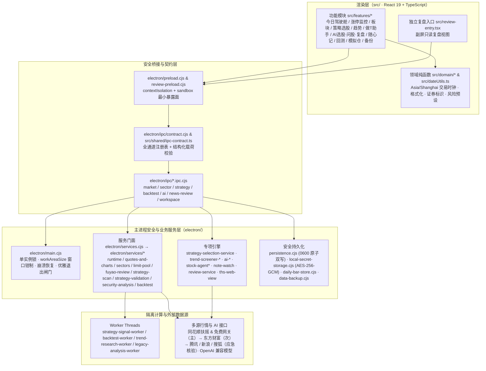

# 项目架构与维护边界（v1.6.71）

本项目是基于 **Electron 44 + React 19 + TypeScript 5.9 + Vite 8** 的本地优先跨平台 A 股研究桌面工作台。整体架构遵循 **渲染层只做视图与交互、主进程掌管安全与状态持久化、服务层负责多源行情编排、工作线程承担密集计算** 的严格分层原则，主进程保持 **零运行时第三方 npm 依赖**（由 `qa/audit-guards.test.cjs` 的 `DEP-4` 守卫强制校验）。

---

## 1. 架构分层全景图



---

## 2. 目录职责与模块图谱

### 2.1 主进程安全基座与持久化（`electron/`）

- `electron/main.cjs`：应用生命周期入口、单实例锁、旧目录数据自动迁移、`tightenUserDataPermissions` 启动早期权限收紧（目录 `0700`、`.json`/`.key` `0600`）、按主显示器 `workAreaSize` 自适应钳制窗口尺寸、渲染进程异常恢复与 `shutdown-gate.cjs` 资源排空。
- `electron/security-policy.cjs`：受控 IPC 主窗口/主 frame 来源校验、返回错误统一包装与敏感令牌脱敏、HTTPS 无凭据外链白名单校验。
- `electron/persistence.cjs`：`0600` 权限原子写入（临时文件 `fsync` → `.last-good` 备份轮转 → 原子 `rename`）、按路径串行异步写入队列（`writeJsonAtomicAsync`）、主备双损坏隔离留档（`.corrupted-*` 限额保留）与目录权限加固。
- `electron/local-kv-sqlite.cjs`：基于 Node 24 内置 `node:sqlite`（`DatabaseSync` + WAL 模式，零第三方依赖、`0600` 权限）的大容量本地键值存储，用于随心记、复盘归档与回测历史持久化。
- `electron/local-secret-storage.cjs`：本机随机密钥文件（`local-secret.key`，`0600`）驱动的 AES-256-GCM 凭据加密存储，支持可选「启动主密码保护」（`AS2` 封包 + 异步 `scrypt` 二次包裹主密钥）；日常运行与升级重签不再触发 macOS 钥匙串弹窗。
- `electron/daily-bar-store.cjs`：全市场不复权日线本地增量库（`userData/daily-bars`），支持收盘快照连续性核验补单根、文件印记免重复全量校验、启动空闲 `.tmp` 与过期退市孤儿日线清扫（`cleanupStaleBars`）、覆盖率估算（`getCoverageSummary`）、重建清空（`clearAllBars`）与存储体积统计（`getStorageStats`）。
- `electron/data-backup.cjs`：面向网盘同步目录的本机数据打包备份（自动剥离 API Key/令牌，支持 `>= 8` 位密码的异步 `scrypt` + `AES-256-GCM` 整包加密并兼容旧版解密、两阶段恢复预检与写入失败回滚、本机存储空间统计摘要 `storageSummary` 与一键清理）。
- `electron/review-window.cjs` & `electron/ths-web-view.cjs`：
  - `review-window.cjs`：独立专业复盘窗口管理，支持 `workAreaSize` 尺寸钳制、主题广播与恢复备份前 `closeWindow()` 强制销毁防本地存储竞争。
  - `ths-web-view.cjs`：沪深港通内嵌网页管理，独立会话 `persist:ths-web`、沙箱无 preload、主帧与子帧（`will-frame-navigate`）同花顺域名白名单拦截、主窗口缩放同步、连续崩溃 `>= 3` 次熔断保护、退出登录连带清理缓存，以及同花顺 6 位个股页代码自动识别（`detectedStockCode`）。

### 2.2 IPC 契约与路由层（`electron/ipc/*` & `src/shared/ipc-contract.ts`）

所有 IPC 通道均由 `electron/ipc-contract.test.cjs` 强制锁定 `preload.cjs`、`review-preload.cjs`、`electron/ipc/contract.cjs` 与 `src/shared/ipc-contract.ts` 四处完全一致：

- `contract.cjs`：集中定义 `MAIN_IPC_CHANNELS`、`REVIEW_IPC_CHANNELS`、`IPC_EVENT_CHANNELS` 与逐通道参数结构校验器。
- `register-all.cjs`：装配外部因子归档并统一注册 7 个域路由：
  - `market.ipc.cjs`：实时报价、多源融合、分时/K 线、涨停/炸板池、可转债、沪深港通视图控制。
  - `sector.ipc.cjs`：行业/概念榜单、板块分类目录、成分详情、概念产业链与板块涨停计数。
  - `strategy.ipc.cjs`：全市场策略选股（含 `statusOnly: true` 同步返回实时进度 `getStrategyScanProgress()`，零新增通道）、自定义策略增删改、趋势扫描与执行检查。
  - `backtest.ipc.cjs`：单股回测与共享现金组合回测任务派发。
  - `ai.ipc.cjs`：AI 模型多配置管理、框架编排、AI 选股打分/总结、大白话生成策略、AI 问股多轮对话与工作区快照同步。
  - `news-review.ipc.cjs`：财联社/东财快讯与公司公告聚合、资讯影响 AI 解读、专业复盘与独立复盘窗口只读接口。
  - `workspace.ipc.cjs`：自选、持仓、系统设置、随心记定时提醒与盘中价格盯盘、系统通知、网盘备份与跨窗安全恢复。

### 2.3 服务编排拆分层（`electron/services/*`）

`electron/services.cjs` 作为稳定门面保持向后兼容导出（由 `electron/services-contract-snapshot.test.cjs` 守卫），核心实现按职责拆分为 9 个子模块：

- `runtime.cjs`：统一作业生命周期（`serviceRuntime` / `chartRuntime`）、Worker 运行器、有界内存缓存（`BoundedCache`）、证券代码与交易所规范化，以及东财 `curl` 备用通道（保留 `ASTOCK_DISABLE_CURL` 测试契约，内置 `activeCurlCount >= 2` 并发闸门与 `HTTP 429/403` 限流免重试风暴保护）。
- `quotes-and-charts.cjs`：同花顺扶摇 / 同花顺免费 / 东方财富 / 腾讯实时报价接力、三线行情共识校验、同花顺实时分时与多周期 K 线聚合、公司公告与市场情绪快照。
- `sectors.cjs`：行业/概念涨跌与资金流榜单、真实成分交集涨停计数、细分产业链。
- `limit-pool.cjs`：涨停池、连板天梯、近 N 日涨停回溯与昨日涨停今日炸板池。
- `fuyao-review.cjs`：同花顺扶摇短线生态 10 路接口聚合与交易/休市分时段缓存。
- `strategy-scan.cjs`：全市场五大板块名单分页拉取与 7 日磁盘名单兜底、本地日线库收盘快照预取、Worker 策略选股调度与交易日级结果缓存。
- `strategy-validation.cjs`：策略定义目录、独立验证样本筛选与报告丰富化。
- `security-analysis.cjs`：个股多维技术结构、策略命中与执行准备度综合研判。
- `backtest.cjs`：单股历史信号回放、共享现金组合回测编排、搜索联想与基础历史拉取。

### 2.4 专项业务引擎（`electron/*.cjs`）

- `market-source-health.cjs`：数据源连续故障指数退避熔断器（30 秒起翻倍至 4 分钟）与 `humanizeSourceError` 可读中文错误归因。
- `trend-screener-adapter.cjs` & `trend-screener-service.cjs` & `trend-screener-engine.cjs`：趋势选股多源适配器（含模块级带过期时间的 `ths.pausedUntil` 与 `failedHosts` 共享记忆，同时支持测试注入隔离）、跨源原价交叉核验与分阶段扫描引擎。
- `strategy-selection-service.cjs` & `strategy-signal-engine.cjs`：全市场 400 只分批流式策略选股（非自选日线算完即释防内存膨胀）与实时进度统计（`active / processed / total / hits / fetched / startedAt / etaSeconds`）。
- `ai-client.cjs` / `ai-frameworks.cjs` / `ai-service.cjs` / `stock-agent*.cjs`：OpenAI 兼容接口客户端（并发限流、HTTP 400 参数自适应降级、禁止跟随重定向防密钥泄露）、14 套情境策略编排 + 实测胜率打分框架、19 种内置打法与多轮工具调用 AI 问股引擎。

### 2.5 前端功能模块层（`src/`）

- `src/domain/` & `src/dateUtils.ts`：不依赖 React 的领域模型、数值格式化与固定 `Asia/Shanghai` 交易日计算（严禁用本地/UTC 时区替代北京时间）。
- `src/features/`：按业务域完全模块化——`cockpit`（今日驾驶舱）、`copilot`（全局副驾驶提醒、状态协调与随心记转做T/盯盘）、`dashboard`（涨停监控与炸板观察）、`market`（个股分析与多股同列）、`sectors`（板块强度与北交所）、`bonds`（可转债）、`hsgt`（沪深港通与个股桥接）、`strategy-selection`（全市场策略选股与我的策略）、`trend`（趋势筛选、冻结计划与趋势研究）、`t-assistant`（做T助手、多周期画线工具箱与做T AI 追问）、`ai-picks`（AI 选股与我的股票）、`ai-agent`（AI 问股与打法管理）、`ai-review`（AI 复盘与解读面板）、`notes`（随心记与价格条件盯盘）、`paper-simulation`（模拟交易）、`backtest`（单股与组合回测中心）、`collections`（自选监控、观察池与持仓账本）、`information`（资讯与公告中心）、`review`（专业复盘协同组件）、`settings` & `backup`（系统设置、安全主密码与网盘加密备份）。

---

## 3. 数据源与安全铁律

1. **固定主次与防风暴熔断**：行情与日线固定以 **同花顺（扶摇官方接口 / 免费网页网关）为主源，东方财富为次源，腾讯 / 新浪 / 搜狐为交叉核验与应急接力**。所有外部请求必须经由 `electron/http-client.cjs` 统一限速、超时、大小上限与跨站重定向凭据剥离，严禁裸调无超时 `fetch`。
2. **缺失值诚实表达**：上游字段缺失一律以 `null` / `暂缺` 传递与展示，严禁静默折算为 `0`、`0.00%` 或伪造成交额（`close * volume`）。
3. **本机隐私最小化外发**：发送给第三方大模型的提示词仅含证券公开行情、指标、公告摘要与用户输入偏好，绝不附带实盘持仓股数、成本、账户资金或任何其他接口密钥；更换 AI 接口域名时强制重新校验对应来源 API Key。

---

## 4. 质量门禁与发布规范

日常研发与发版前统一通过以下门禁验证：

```bash
corepack pnpm verify          # 双入口类型检查 + ESLint + 单测覆盖率 + Web/复盘双构建
corepack pnpm qa:fullstack:ui # Playwright 真实渲染器全模块交互回归
corepack pnpm run deploy      # macOS 唯一软件完整构建、ad-hoc 重签、熔断位与构建回执核验并原子部署
```

- 策略定义变更后须运行 `corepack pnpm catalog:strategy` 同步 `config/strategy-signal-catalog.json`（由 `DEP-3` 守卫核验）。
- 每年底上交所/深交所公布次年休市安排后，按 `docs/operations/market-calendar-update.md` 更新 `config/a-share-market-calendar.json`（由 `TEST-8` 守卫提前 60 天预警）。
